# LAPORAN PRAKTIKUM 4: CSS LAYOUT
**Mata Kuliah:** Pemrograman Web  
**Dosen Pengampu:** Agung Nugroho, M.Kom  
**Program Studi:** Teknik Informatika  
**Fakultas:** Teknik  
**Universitas:** Universitas Pelita Bangsa  

---

## DAFTAR ISI
1. [Identitas Mahasiswa](#identitas-mahasiswa)
2. [Tujuan Praktikum](#tujuan-praktikum)
3. [Dasar Teori](#dasar-teori)
   - [Web Layout](#1-web-layout)
   - [Box Element (CSS Box Model)](#2-box-element-css-box-model)
   - [CSS Float Property](#3-css-float-property)
   - [Clearfix Element](#4-clearfix-element)
   - [HTML5 Semantics Elements](#5-html5-semantics-elements)
4. [Langkah-Langkah Praktikum](#langkah-langkah-praktikum)
   - [1. Box Element Dasar Tanpa Float](#1-box-element-dasar-tanpa-float)
   - [2. Penerapan CSS Float Property](#2-penerapan-css-float-property)
   - [3. Penerapan Clearfix pada Div 4](#3-penerapan-clearfix-pada-div-4)
   - [4. Eksperimen Properti Clear (left, right, both)](#4-eksperimen-properti-clear-left-right-both)
   - [5. Membuat Layout Web Sederhana (lab4_layout)](#5-membuat-layout-web-sederhana-lab4_layout)
   - [6. Styling Header Layout](#6-styling-header-layout)
   - [7. Styling Menu Navigasi](#7-styling-menu-navigasi)
   - [8. Membuat Hero Panel](#8-membuat-hero-panel)
   - [9. Mengatur Layout Main dan Sidebar](#9-mengatur-layout-main-dan-sidebar)
   - [10. Menambahkan Sidebar Widget](#10-menambahkan-sidebar-widget)
   - [11. Mengatur Footer](#11-mengatur-footer)
   - [12. Elemen Multi-Kolom Box dan Featurette Artikel](#12-elemen-multi-kolom-box-dan-featurette-artikel)
   - [13. Tampilan Utuh Home Layout](#13-tampilan-utuh-home-layout)
5. [Jawaban Pertanyaan dan Tugas](#jawaban-pertanyaan-dan-tugas)
   - [Tugas 1: Layout Menu About (Single Layout: Profil, Deskripsi, & Portfolio)](#tugas-1-layout-menu-about)
   - [Tugas 2: Layout Menu Contact (Form Isian Lengkap & Info Kontak)](#tugas-2-layout-menu-contact)
6. [Halaman Tambahan: Menu Artikel](#halaman-tambahan-menu-artikel)
7. [Struktur Direktori Proyek](#struktur-direktori-proyek)
8. [Petunjuk Git & Pengumpulan Tugas](#petunjuk-git--pengumpulan-tugas)
9. [Kesimpulan](#kesimpulan)

---

## Identitas Mahasiswa

| Keterangan | Data Mahasiswa |
| :--- | :--- |
| **Nama Lengkap** | Mahasiswa Pelita Bangsa |
| **NIM** | 312210000 |
| **Kelas** | TI.22.A1 |
| **Mata Kuliah** | Pemrograman Web |
| **Dosen Pengampu** | Agung Nugroho, M.Kom |
| **Instansi** | Universitas Pelita Bangsa |

---

## Tujuan Praktikum
1. Mahasiswa mampu memahami struktur dasar pembuatan Web Layout.
2. Mahasiswa mampu memahami konsep Box Element (Box Model) pada CSS.
3. Mahasiswa mampu memahami cara kerja dan implementasi CSS Floating.
4. Mahasiswa mampu memahami dan menerapkan elemen semantik HTML5 (*HTML5 Semantics Elements*).
5. Mahasiswa mampu membuat Layout Web Sederhana yang rapi, fungsional, dan terstruktur.

---

## Dasar Teori

### 1. Web Layout
Web layout merupakan kerangka acuan yang mengatur penempatan serta tata letak elemen pada halaman web, seperti navigasi, header, hero banner, main content, sidebar, dan footer. Penataan layout yang baik bertujuan menyajikan informasi secara ergonomis, intuitif, dan menawan bagi pengunjung situs.

### 2. Box Element (CSS Box Model)
Semua elemen dalam HTML pada dasarnya diperlakukan sebagai sebuah kotak (*box*). CSS Box Model tersusun atas empat komponen utama:
- **Content:** Area inti tempat teks, gambar, atau media ditampilkan.
- **Padding:** Ruang transparan di antara konten dan border elemen.
- **Border:** Garis pembatas yang mengelilingi padding dan konten.
- **Margin:** Ruang transparan di luar border yang memisahkan elemen tersebut dari elemen lainnya.
- **Box-sizing:** Deklarasi `box-sizing: border-box;` memastikan kalkulasi lebar total elemen sudah mencakup padding dan border.

### 3. CSS Float Property
Properti CSS `float` digunakan untuk menggeser elemen ke sisi kiri (`left`) atau kanan (`right`), sehingga elemen teks atau elemen lain di sekitarnya dapat mengalir di sampingnya. Elemen yang memiliki float akan keluar dari aliran dokumen normal (*normal flow*).

### 4. Clearfix Element
Ketika elemen-elemen anak (*child elements*) menggunakan `float`, elemen induk (*parent element*) sering kali kehilangan tinggi aslinya (*height collapse*). Untuk mengatasi hal ini, digunakan properti `clear` (dengan nilai `left`, `right`, atau `both`) atau teknik **clearfix** modern menggunakan pseudo-element `::after` dengan `clear: both;` dan `display: table;`.

### 5. HTML5 Semantics Elements
HTML5 memperkenalkan elemen semantik yang memberikan makna struktural bagi peramban web (*browser*), perayap mesin pencari (*search engine bot*), dan pembaca layar (*screen reader*).
- `<header>`: Mendefinisikan kepala dokumen atau bagian pembuka.
- `<nav>`: Mendefinisikan kumpulan tautan navigasi utama.
- `<section>`: Mendefinisikan babak atau bagian tematik dalam dokumen.
- `<article>`: Mendefinisikan konten mandiri dan independen.
- `<aside>`: Mendefinisikan konten pelengkap/pendukung di samping konten utama (seperti *sidebar*).
- `<footer>`: Mendefinisikan kaki halaman atau bagian penutup.

---

## Langkah-Langkah Praktikum

### 1. Box Element Dasar Tanpa Float
Sebelum menerapkan float, tiga buah tag `<div>` berturut-turut ditampilkan. Karena elemen `<div>` bertipe *block-level*, masing-masing elemen memakan lebar penuh baris dan tersusun secara vertikal dari atas ke bawah.

**Kode HTML & CSS:**
```html
<style>
    div { padding: 10px; }
    .div1 { background: red; }
    .div2 { background: yellow; }
    .div3 { background: green; }
</style>
<section>
    <div class="div1">Div 1</div>
    <div class="div2">Div 2</div>
    <div class="div3">Div 3</div>
</section>
```

**Screenshot Hasil:**  
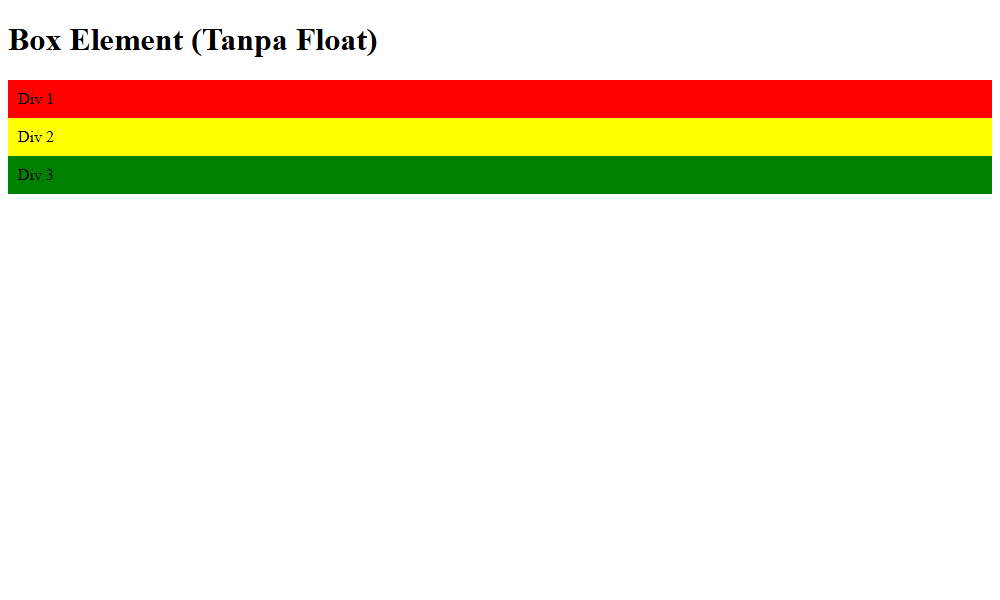

---

### 2. Penerapan CSS Float Property
Selanjutnya ditambahkan properti `float: left;` pada elemen `div`. Properti ini menyebabkan ketiga elemen mengambang dan berjajar ke samping kiri secara horizontal.

**Kode CSS:**
```css
div {
    float: left;
    padding: 10px;
}
.div1 { background: red; }
.div2 { background: yellow; }
.div3 { background: green; }
```

**Screenshot Hasil:**  
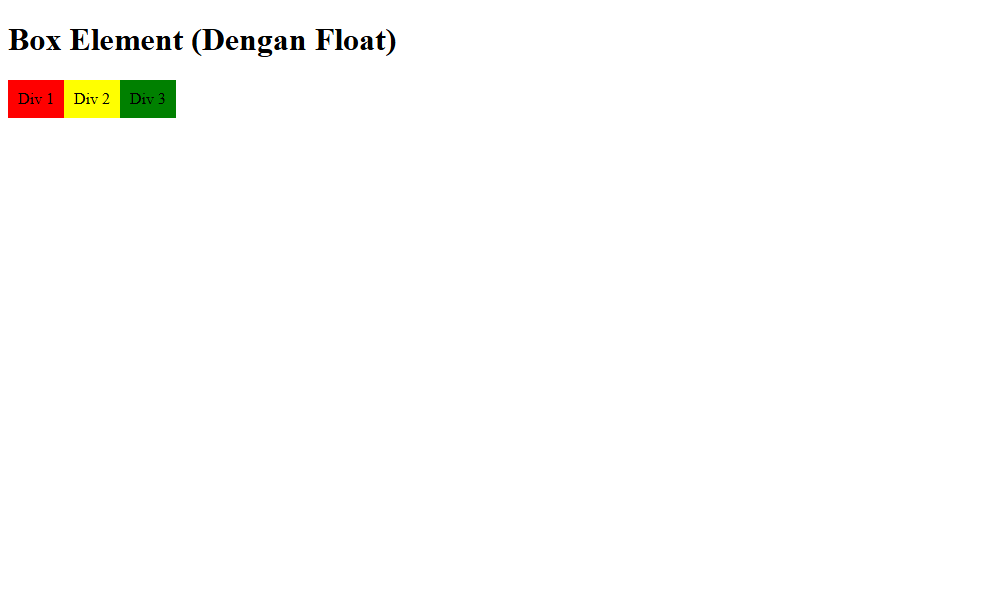

---

### 3. Penerapan Clearfix pada Div 4
Ketika ditambahkan elemen `<div class="div4">Div 4</div>`, elemen tersebut secara default akan mencoba mengalir di samping elemen-elemen yang mengambang sebelumnya. Untuk memaksanya turun ke baris baru di bawah elemen float, digunakan properti `clear: left; float: none;`.

**Kode HTML & CSS:**
```html
<section>
    <div class="div1">Div 1</div>
    <div class="div2">Div 2</div>
    <div class="div3">Div 3</div>
    <div class="div4">Div 4</div>
</section>
```
```css
.div4 {
    background-color: blue;
    clear: left;
    float: none;
    color: white;
}
```

**Screenshot Hasil:**  
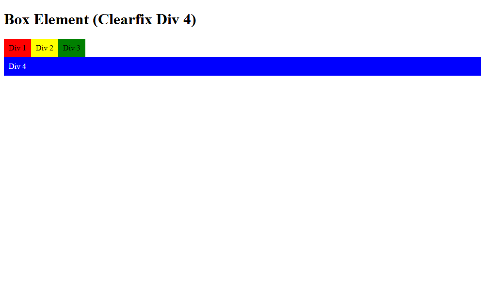

---

### 4. Eksperimen Properti Clear (left, right, both)
Pada modul halaman 5, diminta eksperimen terhadap penggunaan nilai properti `clear`:
- **`clear: left;`**: Elemen tidak mengizinkan adanya elemen float di sisi kiri atasnya. Elemen akan turun ke bawah elemen yang memiliki `float: left`.
- **`clear: right;`**: Elemen tidak mengizinkan adanya elemen float di sisi kanan atasnya. Elemen akan turun ke bawah elemen yang memiliki `float: right`.
- **`clear: both;`**: Elemen membersihkan kedua sisi (kiri maupun kanan). Elemen dijamin berada di bawah seluruh elemen float kiri dan kanan sebelumnya.

**Kode Eksperimen `clear: both;`:**
```html
<style>
    div { float: left; padding: 10px; }
    .div1 { background: red; }
    .div2 { background: yellow; float: right; }
    .div3 { background: green; }
    .div4 { background-color: blue; clear: both; float: none; color: white; }
</style>
<section>
    <div class="div1">Div 1 (Float Left)</div>
    <div class="div2">Div 2 (Float Right)</div>
    <div class="div3">Div 3 (Float Left)</div>
    <div class="div4">Div 4 (Clear: Both)</div>
</section>
```

**Screenshot Hasil:**  
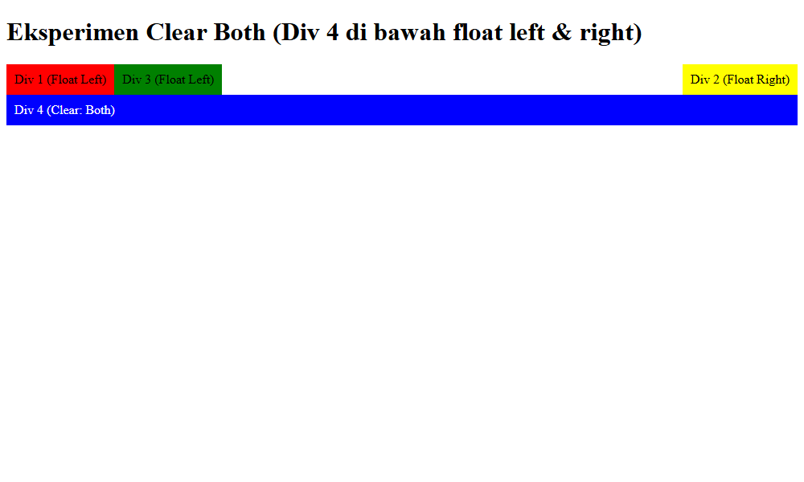

---

### 5. Membuat Layout Web Sederhana (`lab4_layout`)
Dibuat struktur folder `lab4_layout/` dengan file `home.html` dan `style.css`. Langkah awal adalah menyusun kerangka semantik HTML5 di dalam kontainer `#container`.

**Kerangka HTML:**
```html
<!DOCTYPE html>
<html lang="en">
<head>
    <meta charset="UTF-8">
    <meta name="viewport" content="width=device-width, initial-scale=1.0">
    <title>Layout Sederhana</title>
    <link rel="stylesheet" href="style.css">
</head>
<body>
    <div id="container">
        <header>
            <h1>Layout Sederhana</h1>
        </header>
        <nav>
            <a href="home.html" class="active">Home</a>
            <a href="artikel.html">Artikel</a>
            <a href="about.html">About</a>
            <a href="kontak.html">Kontak</a>
        </nav>
        <section id="hero"></section>
        <section id="wrapper">
            <section id="main"></section>
            <aside id="sidebar"></aside>
        </section>
        <footer>
            <p>&copy; 2021 - Universitas Pelita Bangsa</p>
        </footer>
    </div>
</body>
</html>
```

**Screenshot Hasil Kerangka:**  
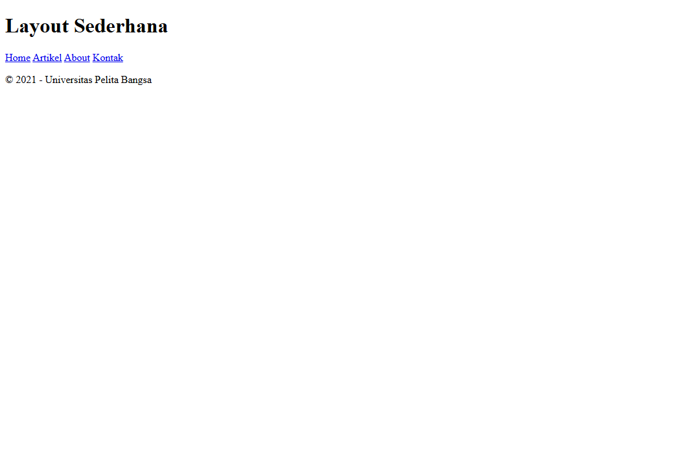

---

### 6. Styling Header Layout
Menerapkan Google Fonts (*Open Sans*), CSS Reset (`* { margin: 0; padding: 0; }`), serta membungkus halaman di dalam kontainer selebar `980px` dengan efek bayangan `box-shadow`.

**Kode CSS Header:**
```css
#container {
    width: 980px;
    margin: 0 auto;
    box-shadow: 0 0 1em #cccccc;
    background-color: #ffffff;
}
header {
    padding: 20px;
}
header h1 {
    margin: 20px 10px;
    color: #b5b5b5;
}
```

**Screenshot Hasil Header:**  
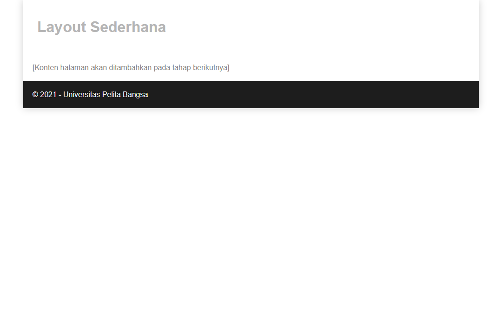

---

### 7. Styling Menu Navigasi
Menambahkan gaya pada bilah navigasi dengan latar belakang biru `#1f5faa` dan efek interaktif `:hover` serta state `.active` warna biru cerah `#2b83ea`.

**Kode CSS Navigasi:**
```css
nav {
    display: block;
    background-color: #1f5faa;
}
nav a {
    padding: 15px 30px;
    display: inline-block;
    color: #ffffff;
    font-size: 14px;
    text-decoration: none;
    font-weight: bold;
}
nav a.active,
nav a:hover {
    background-color: #2b83ea;
}
```

**Screenshot Hasil Navigasi:**  
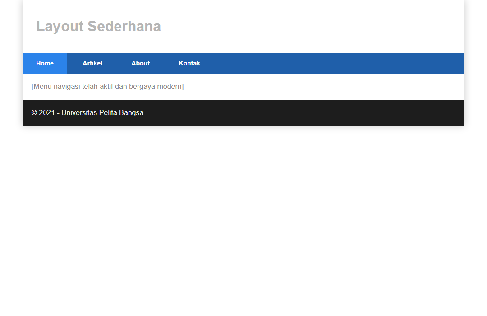

---

### 8. Membuat Hero Panel
Hero panel ditempatkan di bawah navigasi sebagai area sorotan utama (*jumbotron*) dengan judul tebal, deskripsi, dan tombol CTA (*Call to Action*).

**Kode HTML Hero:**
```html
<section id="hero">
    <h1>Hello World!</h1>
    <p>Lorem ipsum dolor sit amet, consectetur adipiscing elit. Vestibulum lorem elit, iaculis innisl volutpat, malesuada tincidunt arcu. Proin in leo fringilla, vestibulum mi porta, faucibus felis. Integer pharetra est nunc, nec pretium nunc pretium ac.</p>
    <a href="home.html" class="btn btn-large">Learn more &raquo;</a>
</section>
```

**Screenshot Hasil Hero Panel:**  
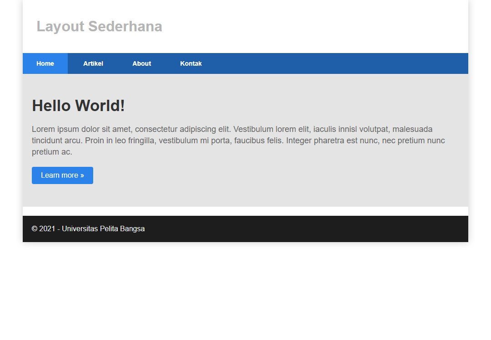

---

### 9. Mengatur Layout Main dan Sidebar
Membagi area `#wrapper` menjadi dua kolom sejajar menggunakan teknik float:
- Area `#main`: `float: left; width: 640px; padding: 20px;`
- Area `#sidebar`: `float: left; width: 340px; padding: 20px;`

**Screenshot Hasil Main & Sidebar:**  
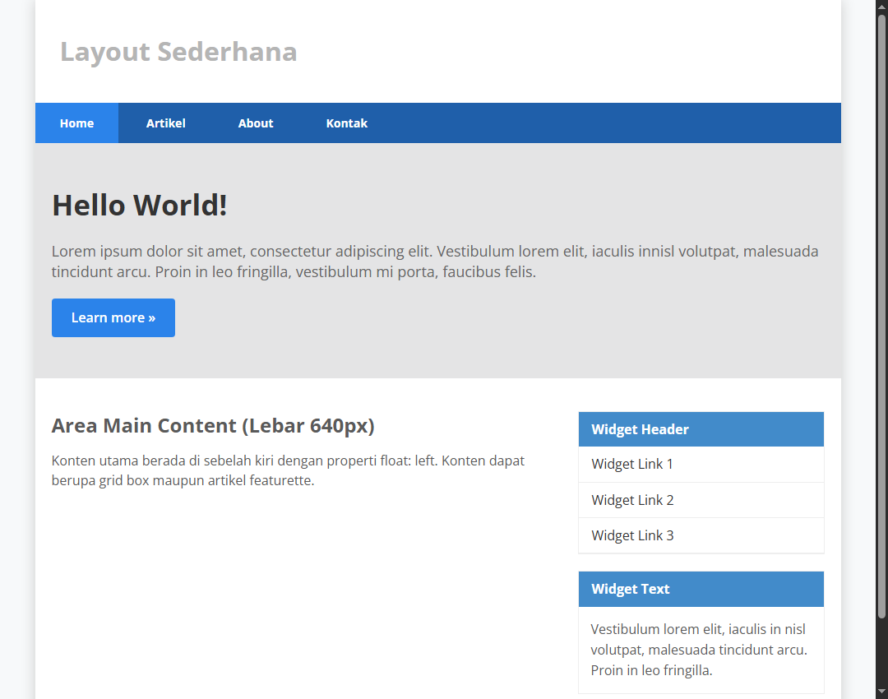

---

### 10. Menambahkan Sidebar Widget
Pada area sidebar ditambahkan dua widget: widget navigasi (*Widget Header*) berisi daftar link vertikal dengan hover state, dan widget teks (*Widget Text*).

**Kode HTML Sidebar Widget:**
```html
<aside id="sidebar">
    <div class="widget-box">
        <h3 class="title">Widget Header</h3>
        <ul>
            <li><a href="#">Widget Link</a></li>
            <li><a href="#">Widget Link</a></li>
            <li><a href="#">Widget Link</a></li>
            <li><a href="#">Widget Link</a></li>
            <li><a href="#">Widget Link</a></li>
        </ul>
    </div>
    <div class="widget-box">
        <h3 class="title">Widget Text</h3>
        <p>Vestibulum lorem elit, iaculis in nisl volutpat, malesuada tincidunt arcu. Proin in leo fringilla, vestibulum mi porta, faucibus felis.</p>
    </div>
</aside>
```

---

### 11. Mengatur Footer
Bagian footer diberikan properti `clear: both;` agar posisinya selalu berada di bawah kolom main dan sidebar, dengan latar belakang gelap `#1d1d1d` dan teks abu-abu terang `#eee`.

**Kode CSS Footer:**
```css
footer {
    clear: both;
    background-color: #1d1d1d;
    padding: 20px;
    color: #eee;
}
```

---

### 12. Elemen Multi-Kolom Box dan Featurette Artikel
Pada area `#main` ditambahkan:
1. Tiga kolom box bundar (*circular images*) dengan persentase lebar `33.333333%` dan class `.image-circle` (`border-radius: 50%`).
2. Garis pemisah `<hr class="divider" />`.
3. Dua blok `<article class="entry">` dengan float gambar ke kiri dan float gambar ke kanan (`.right-img`).
4. Aturan clearfix pada `.row:after` dan `.entry:after` menggunakan `display: table; clear: both;`.

---

### 13. Tampilan Utuh Home Layout
Hasil integrasi menyeluruh dari file `home.html` dan `style.css` sesuai modul Praktikum 4 (Gambar 4.7 & 4.16).

**Screenshot Hasil Lengkap Home:**  
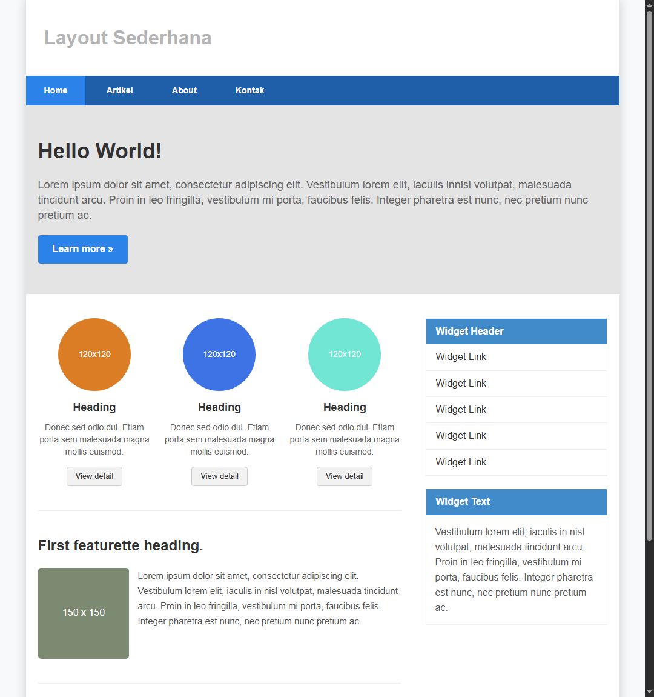

---

## Jawaban Pertanyaan dan Tugas

### Tugas 1: Layout Menu About
> **Pertanyaan/Tugas:** Tambahkan Layout untuk menu About  
> **Ketentuan:** Buat single layout yang berisi deskripsi, portfolio, dll.

#### Solusi & Penjelasan Implementasi:
File dibuat dengan nama [about.html](lab4_layout/about.html). Sesuai instruksi *"single layout"*, halaman ini tidak menggunakan pemisahan sidebar widget konvensional, melainkan mengadopsi tata letak satu kolom utuh (*full-width single container*) yang bersih, elegan, dan profesional.

**Komponen Halaman About:**
1. **Profil Pengembang (*Profile Card*):**
   - Menampilkan foto avatar circular dengan aksen border biru.
   - Nama mahasiswa dan status: *Mahasiswa Teknik Informatika - Universitas Pelita Bangsa*.
   - Bio/ringkasan fokus keahlian di bidang front-end web development dan UI/UX design.
2. **Deskripsi Diri & Minat Akademik:**
   - Ulasan komprehensif mengenai penerapan konsep Box Element, CSS Float, Clearfix, dan HTML5 Semantics.
3. **Galeri Portofolio Proyek (*Portfolio Grid*):**
   - Layout grid 2x2 multi-kolom responsif dengan kartu karya (*project cards*).
   - Menampilkan 4 proyek:
     1. *E-Commerce Web Portal* (HTML5, CSS Layout, JavaScript)
     2. *Analytics Dashboard UI* (CSS Grid, Semantics, UI/UX)
     3. *Portal Informasi Destinasi Wisata* (CSS Floating, Clearfix)
     4. *Sistem Informasi Akademik / SIAKAD* (Semantic Web, Form Handling)
   - Disertai gambar representatif dan badge teknologi pendukung.
4. **Keahlian & Penguasaan Teknologi (*Skills Progress Bar*):**
   - Baris visual persentase penguasaan teknologi web (HTML5 Semantics, CSS3 Layouting, Responsive Design, Git & GitHub).

**Cuplikan Kode [about.html](lab4_layout/about.html):**
```html
<div class="single-content">
    <div class="profile-card">
        
        <div class="bio">
            <h2>Mahasiswa Pemrograman Web</h2>
            <h4>Teknik Informatika - Universitas Pelita Bangsa</h4>
            <p>Mahasiswa berfokus pada pengembangan antarmuka web modern, CSS layouting, dan standar HTML5 Semantics.</p>
        </div>
    </div>

    <h3 class="section-title">Portofolio Karya & Proyek Web</h3>
    <div class="portfolio-grid">
        <div class="portfolio-card">
            <div class="portfolio-inner">
                
                <h3>E-Commerce Web Portal</h3>
                <p>Platform katalog penjualan online responsif dengan tata letak modern.</p>
                <div><span class="tag-badge">HTML5</span><span class="tag-badge">CSS Layout</span></div>
            </div>
        </div>
        <!-- Proyek portofolio lainnya -->
    </div>
</div>
```

**Screenshot Halaman About:**  
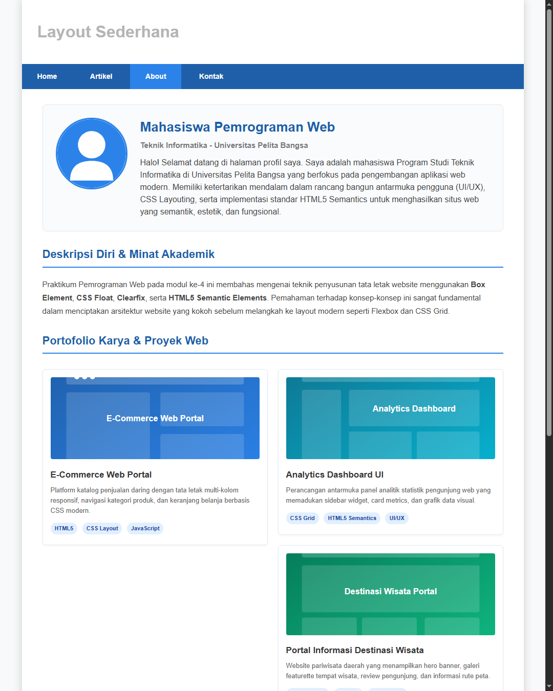

---

### Tugas 2: Layout Menu Contact
> **Pertanyaan/Tugas:** Tambahkan layout untuk menu Contact  
> **Ketentuan:** Berisi form isian: nama, email, message, dll.

#### Solusi & Penjelasan Implementasi:
File dibuat dengan nama [kontak.html](lab4_layout/kontak.html) (serta alias [contact.html](lab4_layout/contact.html)). Tata letak halaman mengombinasikan area formulir interaktif di kolom utama (`#main`) dan widget informasi kontak di kolom pendukung (`#sidebar`).

**Komponen Formulir Kontak:**
1. **Field Form Isian Lengkap:**
   - **Nama Lengkap:** Input teks wajib isi (`required`).
   - **Alamat Email:** Input email dengan validasi format peramban (`type="email"`).
   - **Nomor Telepon / WhatsApp:** Input nomor kontak aktif pemohon.
   - **Subjek Pesan:** Input teks penentu topik komunikasi.
   - **Pesan / Message:** Elemen `<textarea>` responsif untuk menyampaikan pertanyaan atau kebutuhan.
   - **Tombol Kirim Pesan & Reset:** Tombol submit dengan style `.btn .btn-large` dan tombol reset `.btn .btn-default`.
2. **Sidebar Informasi Kontak Kampus:**
   - Alamat lengkap Kampus Universitas Pelita Bangsa (Cikarang Pusat, Bekasi).
   - Email resmi dan nomor telepon/WhatsApp departemen.
   - Jam operasional layanan akademik (Senin - Sabtu).
   - Widget tautan cepat ke beranda, arsip artikel, dan W3C Validator.

**Cuplikan Kode [kontak.html](lab4_layout/kontak.html):**
```html
<form action="#" method="post">
    <div class="form-group">
        <label for="nama">Nama Lengkap *</label>
        <input type="text" id="nama" name="nama" class="form-control" placeholder="Masukkan nama lengkap Anda" required>
    </div>
    <div class="form-group">
        <label for="email">Alamat Email *</label>
        <input type="email" id="email" name="email" class="form-control" placeholder="nama@domain.com" required>
    </div>
    <div class="form-group">
        <label for="telepon">Nomor Telepon / WhatsApp</label>
        <input type="tel" id="telepon" name="telepon" class="form-control" placeholder="Contoh: 081234567890">
    </div>
    <div class="form-group">
        <label for="subjek">Subjek Pesan *</label>
        <input type="text" id="subjek" name="subjek" class="form-control" required>
    </div>
    <div class="form-group">
        <label for="pesan">Pesan / Message *</label>
        <textarea id="pesan" name="pesan" class="form-control" required></textarea>
    </div>
    <div class="form-group">
        <button type="submit" class="btn btn-large">Kirim Pesan &raquo;</button>
        <button type="reset" class="btn btn-default">Reset Form</button>
    </div>
</form>
```

**Screenshot Halaman Contact:**  
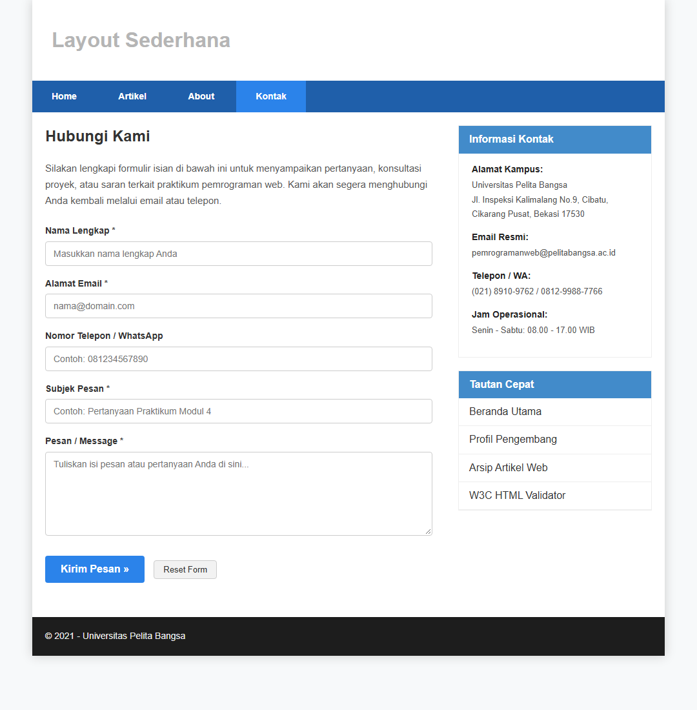

---

## Halaman Tambahan: Menu Artikel
Untuk memastikan seluruh tautan navigasi (`Home`, `Artikel`, `About`, `Kontak`) berfungsi secara utuh dan terhubung, dibuat pula halaman [artikel.html](lab4_layout/artikel.html) yang memuat artikel edukatif seputar CSS Box Model, CSS Float, Clearfix, dan HTML5 Semantics.

**Screenshot Halaman Artikel:**  
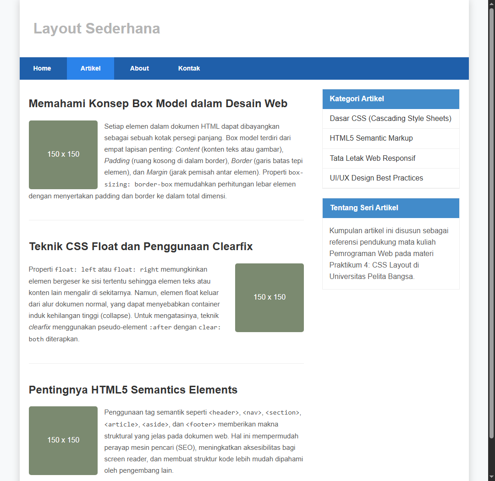

---

## Struktur Direktori Proyek

```text
Lab4Web/
├── .git/                               # Direktori Git Version Control
├── README.md                           # Laporan praktikum lengkap (dokumen ini)
├── lab4_box.html                       # Praktikum latihan box element & float/clearfix
├── screenshots/                        # Dokumentasi screenshot hasil setiap tahapan
│   ├── 01_box_tanpa_float.png
│   ├── 02_box_dengan_float.png
│   ├── 03_box_clearfix_div4.png
│   ├── 04_box_clear_both.png
│   ├── 05_layout_kerangka.png
│   ├── 06_layout_header.png
│   ├── 07_layout_navigasi.png
│   ├── 08_layout_hero.png
│   ├── 09_layout_sidebar.png
│   ├── 10_layout_home_lengkap.png
│   ├── 11_tugas_about_page.png
│   ├── 12_tugas_contact_page.png
│   └── 13_artikel_page.png
└── lab4_layout/                        # Folder utama implementasi layout web
    ├── home.html                       # Halaman utama praktikum (Gambar 4.7)
    ├── about.html                      # Jawaban Tugas 1: Single layout About & Portfolio
    ├── kontak.html                     # Jawaban Tugas 2: Layout Contact dengan Form isian
    ├── contact.html                    # Redirection alias ke kontak.html
    ├── artikel.html                    # Halaman artikel pendukung
    ├── style.css                       # Stylesheet CSS layout & komponen responsif
    └── images/                         # Aset visual pendukung (SVG)
        ├── avatar.svg
        ├── circle_blue.svg
        ├── circle_orange.svg
        ├── circle_teal.svg
        ├── featurette.svg
        ├── portfolio1.svg
        ├── portfolio2.svg
        ├── portfolio3.svg
        └── portfolio4.svg
```

---

## Petunjuk Git & Pengumpulan Tugas

Sesuai instruksi poin 1, 5, dan 6 pada modul:
1. **Inisialisasi Repository Git:**
   ```bash
   git init
   git add .
   git commit -m "feat: complete Praktikum 4 CSS Layout, Pertanyaan dan Tugas, serta Laporan"
   ```
2. **Menghubungkan ke Remote Repository (GitHub / GitLab):**
   ```bash
   git remote add origin https://github.com/username-anda/Lab4Web.git
   git branch -M main
   git push -u origin main
   ```
3. **Pengiriman ke E-Campus:**
   Kirimkan tautan (*URL*) repository GitHub Anda ke portal e-learning ecampus Universitas Pelita Bangsa pada penugasan Praktikum 4.

---

## Kesimpulan

Berdasarkan praktikum yang telah dilaksanakan, dapat ditarik beberapa kesimpulan penting:
1. **Struktur Web Layout:** Penataan elemen web menggunakan kerangka yang terorganisir memudahkan pengguna menavigasi konten dan meningkatkan estetika antarmuka.
2. **Konsep Box Model:** Setiap elemen HTML memiliki margin, border, padding, dan content. Penggunaan `box-sizing: border-box;` sangat dianjurkan untuk mempermudah perhitungan dimensi layout secara presisi.
3. **CSS Float & Clear:** Properti `float` memungkinkan perataan elemen secara horizontal, sedangkan properti `clear` (khususnya `clear: both;` atau teknik *clearfix*) mutlak diperlukan untuk mencegah masalah *height collapse* pada elemen pembungkus (*parent*).
4. **HTML5 Semantic Elements:** Penggunaan tag `<header>`, `<nav>`, `<section>`, `<article>`, `<aside>`, dan `<footer>` menjadikan kode lebih terstruktur, mudah dipelihara, ramah SEO, dan memenuhi standar aksesibilitas web modern.
5. **Penyelesaian Tugas:** Halaman **About** berhasil dibangun sebagai *single layout* yang elegan dengan portofolio proyek dan keterampilan, serta halaman **Contact** berhasil mengintegrasikan formulir interaktif lengkap beserta informasi kontak universitas.
